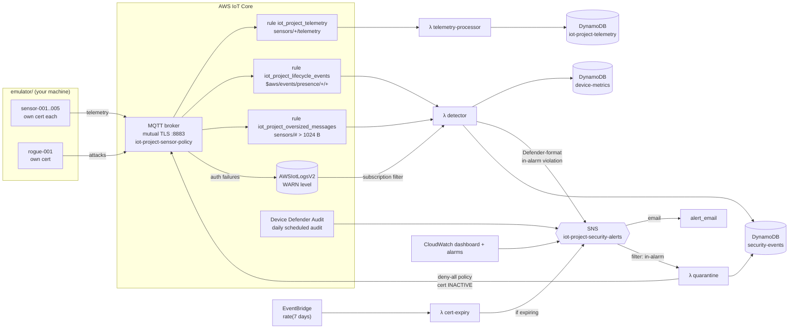

# iot-project: per-device X.509 identity on AWS IoT Core

A cloud-only demo of certificate-based device security on AWS IoT Core. There is no hardware:
a Python emulator plays five well-behaved industrial sensors and one rogue device, each with
its own AWS-issued X.509 certificate.

The demo shows that:

1. **Every device has its own certificate.** Without a valid one, a device can't connect.
2. **Least privilege applies.** A device can publish and subscribe only on its own topics.
3. **Good telemetry lands in DynamoDB.**
4. **A rogue device is detected and quarantined automatically.** You get an email alert, and a
   Lambda attaches a deny-all policy and sets the certificate INACTIVE. The other sensors
   keep working.
5. **A weekly check reports certificates close to expiry.**

Everything is Terraform-managed in `ap-south-1`, tagged `Project = iot-project`, and
`make destroy` removes it all (see [Teardown](#teardown)).

> **Device Defender Detect is not used, by default.** AWS closed Device Defender *Detect*
> (security profiles, rules/ML detect) to new customers on 31 Aug 2026. Accounts that weren't
> already using it get `UnauthorizedException: This feature is no longer available to new
> customers`. This project therefore ships its own **detector Lambda**. It evaluates the same
> four cloud-side rules and publishes messages in the exact Device Defender violation format,
> so the alerting and quarantine path is unchanged. The real security profile is still in
> [infra/defender.tf](infra/defender.tf), behind `enable_device_defender_detect` (default
> `false`), for accounts that still have Detect. Device Defender **Audit** is unaffected and
> is enabled.

## Architecture



## Components in plain English

| Piece | What it does |
|---|---|
| **Things and certificates** ([iot_identity.tf](infra/iot_identity.tf)) | Six things (`iot-project-sensor-001`…`005`, `iot-project-rogue-001`) of type `iot-project-industrial-sensor`, all in thing group `iot-project-sensors`. AWS IoT generates one certificate and key pair per thing. Each certificate is attached to its thing and to the sensor policy. The files are written to `certs/`. |
| **Sensor policy** ([iot_policies.tf](infra/iot_policies.tf)) | A device may connect only with its own thing name as client ID, and only if its certificate is attached to that thing. It may publish only to `sensors/<self>/telemetry` and `/status`, and subscribe only to `sensors/<self>/commands` and `/config`. It may touch only its own shadow. |
| **Quarantine policy** | An explicit `Deny iot:*`. An explicit deny beats any allow, so a quarantined certificate can do nothing. |
| **Logging** ([monitoring.tf](infra/monitoring.tf)) | AWS IoT logs at `WARN` to `AWSIotLogsV2`, which captures every authorization or connect failure. |
| **Telemetry path** ([data_path.tf](infra/data_path.tf)) | The IoT rule `SELECT *, topic(2) AS deviceId, timestamp() AS ts FROM 'sensors/+/telemetry'` invokes `iot-project-telemetry-processor`. That Lambda validates the reading and writes it to `iot-project-telemetry` (PK `deviceId`, SK `ts`, TTL 30 days). |
| **Detector** ([defender.tf](infra/defender.tf), [detector.py](lambdas/detector.py)) | Counts four behaviours per device in 5-minute windows: auth failures > 5, connection attempts > 10, disconnects > 5, and any message > 1024 bytes. It attributes each event to the thing that owns the **certificate**, not to the client ID the device claims. So a rogue that connects as `sensor-001` is charged to the rogue, never to sensor-001. On a breach it publishes one Defender-format violation to SNS. |
| **Device Defender Audit** | Account audit with a daily scheduled audit covering certificate expiring, certificate shared, overly permissive policy, logging disabled, conflicting client IDs, revoked-cert-still-active and key quality. Findings go to the same SNS topic. |
| **Quarantine** ([response.tf](infra/response.tf), [quarantine.py](lambdas/quarantine.py)) | Subscribed to the alert topic with a filter so that only `violationEventType = in-alarm` messages invoke it. It finds the thing's certificates, attaches the quarantine policy, detaches every other policy, sets the certificate INACTIVE, and records the action in `iot-project-security-events`. It is idempotent and refuses things outside the project. It can also be run manually with `{"thingName": "...", "reason": "..."}`. |
| **Certificate expiry** ([cert_expiry.py](lambdas/cert_expiry.py)) | Runs every 7 days through EventBridge. It lists every certificate and reports those expiring within 30 days, emailing a summary when there are any. |
| **Monitoring** | Dashboard `iot-project-dashboard` showing connects, auth errors, blocked publishes and subscribes, violations, quarantines, and Lambda errors and invocations. Alarms on `Connect.AuthError` and on every Lambda's errors go to the alert topic. |
| **Guardrails** ([budget.tf](infra/budget.tf)) | A $5/month budget that emails at 50% and 100%. Resource Group `iot-project` lists every tagged resource. |

## Deploy

Prerequisites: Terraform ≥ 1.6, Python 3.12, AWS credentials with admin rights in the target account.

```bash
cp infra/terraform.tfvars.example infra/terraform.tfvars   # set alert_email
make init
make deploy
```

Without `make` (e.g. Windows PowerShell):

```bash
python -m venv .venv
.venv/Scripts/python -m pip install -r emulator/requirements.txt -r lambdas/requirements-dev.txt
terraform -chdir=infra init
terraform -chdir=infra apply
```

AWS then emails `alert_email` a **subscription confirmation**. Click it, or no alert emails
will arrive. Quarantine still works without it, because it is a separate Lambda subscription.

## Demo script

Run from `emulator/` with `../.venv/Scripts/python` on Windows or `../.venv/bin/python` elsewhere.

| Step | Command | What you should see |
|---|---|---|
| 1. Healthy fleet | `python emulator.py fleet` | Five sensors connect (CONNACK SUCCESS), subscribe to their own `commands` topic and publish telemetry every 60 s. `python emulator.py status` shows the rows arriving in DynamoDB. |
| 2. Least privilege | `python emulator.py cross-topic sensor-002` | Its own topic is `PUBACK SUCCESS`. sensor-001's topics, shadow and `sensors/#` are `NOT_AUTHORIZED`. Connecting with client ID sensor-001 is refused. The summary reads PASS. |
| 3. Authentication | `python emulator.py no-cert` | A self-signed certificate, no client certificate at all, and a valid certificate paired with the wrong key are all rejected during the TLS handshake. |
| 4. Rogue device | `python emulator.py rogue` | rogue-001 sends 4 KB payloads, 10 forbidden publish/subscribe attempts, impersonates sensor-001 and runs a 12-cycle reconnect storm. The first 4 KB message raises a violation, and the device is quarantined about 6 seconds later. Partway through the storm its connects start failing. You get an email, and `status` shows rogue-001 **INACTIVE** with `iot-project-quarantine-policy`. |
| 5. Stolen certificate | `python emulator.py reset rogue-001`, then `python emulator.py stolen-cert` | Two clients share rogue-001's certificate and keep kicking each other off (`SESSION_TAKEN_OVER`). The sixth `DUPLICATE_CLIENTID` disconnect trips the detector and the device is quarantined again. A clone client ID is refused. The daily audit also checks `DEVICE_CERTIFICATE_SHARED_CHECK`. |
| 6. Fleet unaffected | `python emulator.py status` | The five sensors are still ACTIVE with fresh telemetry. |
| Manual quarantine | `python emulator.py quarantine rogue-001 --reason "demo"` | Invokes the same Lambda directly. |
| Repeat the demo | `python emulator.py reset rogue-001` | Re-activates the certificate, restores the sensor policy and clears the detector's counters for that device. |

The Makefile wraps these: `make demo-fleet`, `make demo-attack`, `make quarantine`, `make reset`, `make status`.

### How detection behaves (observed in testing)

- **Sources:** auth failures come from `AWSIotLogsV2`, where AWS logs denied *publishes* and
  *connects* at ERROR. Denied MQTT 5 *subscribes* get `SUBACK NOT_AUTHORIZED` at the device,
  but AWS neither logs them nor counts them in a metric (`Subscribe.AuthError` never appears),
  so only the emulator output shows them. Connection attempts and disconnects come
  from lifecycle events (`connected`, `connect_failed`, `disconnected`). Message size comes
  from an IoT rule that forwards only payloads over ~1 KB.
- **Windows** are fixed 5-minute buckets. A violation is raised once per device, rule and
  window.
- **`cross-topic` stays under the threshold on purpose.** One run makes 5 denied attempts, and
  the rule fires above 5. Running it twice within 5 minutes *will* quarantine that sensor.
  That is correct behaviour, so use `reset` afterwards.
- **Enforcement lag:** the quarantine Lambda finishes within about a second of the alert. AWS
  IoT then takes up to about 20 seconds to refuse new connections from the deactivated
  certificate.

**Note on drift:** quarantine changes the rogue certificate outside Terraform. Terraform
ignores certificate status after creation (`ignore_changes = [active]`), so a later
`terraform apply` never silently re-activates a quarantined device. Use `emulator.py reset`
to restore it.

## Live dashboard (Grafana)

A local Grafana shows the whole story on one screen while the emulator runs. It refreshes
every 10 s:

| Section | Shows |
|---|---|
| Header | Telemetry stored · actions blocked by AWS IoT (publish / connect / bad certificate) · violations · quarantines |
| 1 · Fleet telemetry | Temperature per device, messages per device per minute, latest reading table |
| 2 · Attacks blocked | Blocked per minute, plus a table of every denied action: claimed client ID vs. the real certificate, topic, reason |
| 3 · Detection and response | Security timeline (VIOLATION → QUARANTINED, newest first) and violations/quarantines over time |
| 4 · Platform health | Lambda invocations and errors, successful connections and publishes |

Grafana runs on your machine (`127.0.0.1:3000`, anonymous read-only viewing) and needs no
admin rights. It uses your AWS profile only to assume `iot-project-grafana-readonly`. That
role can read CloudWatch metrics and the project's log groups, nothing else. The CloudWatch
Logs Insights queries cost a fraction of a cent per demo.

```bash
powershell -File grafana/install.ps1
```

This downloads Grafana 13.2.4 portable (~470 MB) into `tools/` and checks its SHA-256. You
only need it once. Then start Grafana:

```bash
AWS_PROFILE=re3-deploy powershell -File grafana/start.ps1
```

Open **http://localhost:3000/d/iot-project?kiosk** for the full-screen presentation view. To
edit the dashboard, log in as `admin` / `admin`; Grafana asks you to change the password. The
panels are generated by [grafana/build_dashboard.py](grafana/build_dashboard.py), so change
that script and rerun it rather than editing the JSON by hand.

**Suggested presentation flow:** put Grafana on one half of the screen and a terminal on the
other.

1. `emulator.py reset rogue-001`, then `emulator.py fleet --interval 15`. The temperature lines
   and message bars start climbing.
2. In a second terminal, `emulator.py cross-topic sensor-002` and then `emulator.py no-cert`.
   "Blocked" ticks up, and the table shows which certificate tried which topic. The fleet's
   sensor-002 is briefly offline while its identity is borrowed, then reconnects.
3. `emulator.py rogue`. Within seconds the timeline shows **VIOLATION**, then **QUARANTINED**.
   The rogue's message bars stop while the five sensors carry on.

## Cost

Measured against list prices for `ap-south-1`. Expect **well under $1/month** when idle and a
few cents for each demo run.

| Item | Estimate |
|---|---|
| IoT Core connectivity + messages + rule actions (demo runs only) | < $0.05 |
| Lambda (4 functions, arm64, 128 MB) | free tier / < $0.01 |
| DynamoDB on-demand + PITR (tiny tables, TTL 30 days) | < $0.05 |
| CloudWatch: 1 dashboard (first 3 free), 5 alarms ($0.10 each beyond the 10 free), 2 custom metrics from log filters ($0.30 each beyond the 10 free), logs at WARN with 14-day retention | $0 – $1.10 |
| Device Defender Audit (6 devices, daily) | < $0.01 |
| SNS email, EventBridge, Budgets (first 2 free), Resource Groups | $0 |

AWS Config, Security Hub, ML Detect and KMS customer-managed keys are deliberately not used.
The `iot-project-monthly` budget emails at $2.50 and $5.00. It is account-wide, because
cost-allocation tags take a day to activate.

## Teardown

```bash
make destroy
```

This deletes the certificates, the policies, the things, every Lambda, table, log group,
alarm and the dashboard.

A quarantined certificate needs one extra step, and `make destroy` does it first. The
quarantine Lambda attaches `iot-project-quarantine-policy` outside Terraform, and AWS IoT
won't delete a certificate or a policy while they're attached. A plain `terraform destroy`
therefore stops with `DeleteConflictException: Certificate policies must be detached before
deletion`. Without `make`, detach the policy first:

```bash
cd emulator && ../.venv/Scripts/python.exe emulator.py pre-destroy   # bin/python on Linux/macOS
terraform -chdir=infra destroy
```

`pre-destroy` finds the policy in Terraform state rather than in the outputs, so it also
finishes a destroy that already failed part-way. It also resets the account's IoT logging
and Device Defender audit configuration, which this project created. The local `certs/` files
are removed too.

## Security notes

- **Private keys live in Terraform state** (`infra/terraform.tfstate`) and in `certs/`. Both are
  gitignored. This is acceptable for a lab, never for production. In production, devices
  generate their own key and send a CSR (`aws_iot_certificate.csr`), or use fleet
  provisioning, so the key never leaves the device.
- Each Lambda has its own role with only the actions and resource ARNs it needs. Only
  `iot:ListAttachedPolicies` and `iot:ListCertificates` use `*`, because AWS doesn't support
  resource-level permissions for them. The audit role uses the AWS-managed read-only
  `AWSIoTDeviceDefenderAudit` policy. There are no `*FullAccess` policies.

## Resources that can't carry the `Project` tag

These are grouped in other ways (the thing group, or naming) instead:

| Resource | Why / how it is grouped |
|---|---|
| IoT things | Not taggable. All are in thing group `iot-project-sensors`. |
| IoT certificates | Not taggable. Attached to the things in `iot-project-sensors`. |
| Thing principal attachments, policy attachments, thing-group memberships | Relationships, not resources. |
| IoT logging options, Device Defender account audit configuration | Account-level settings. |
| IoT topic rules | Taggable, but their names can only use `[A-Za-z0-9_]`, so they are `iot_project_*` instead of `iot-project-*`. |
| `AWSIotLogsV2` log group | Tagged, but AWS IoT requires this fixed name. |
| CloudWatch dashboard | Not taggable through Terraform (`aws_cloudwatch_dashboard` has no tags). Named `iot-project-dashboard`. |
| IAM roles, budget | **Tagged**, but they don't appear in the Resource Group: IAM and Budgets are global, and Resource Groups are regional. Find them by the `iot-project-` name prefix. |
| Lambda permissions, SNS subscriptions, IAM inline role policies, log subscription and metric filters, EventBridge target | Sub-resources without tags of their own. |
| Local files (`certs/`, `build/`) | Not AWS resources. |

## Repository layout

```
infra/       Terraform: providers, variables, iot_identity, iot_policies, defender,
             data_path, response, monitoring, budget, outputs, modules/python_lambda
lambdas/     telemetry_processor.py, detector.py, quarantine.py, cert_expiry.py, tests/
emulator/    emulator.py (awsiotsdk MQTT 5 over mutual TLS), requirements.txt
grafana/     install.ps1, start.ps1, grafana.ini, provisioning/, dashboards/, build_dashboard.py
.github/     CI: terraform fmt/validate, tflint, checkov, Lambda unit tests (no apply)
.checkov.yaml  checkov skips, each with its cost/lab justification
```
